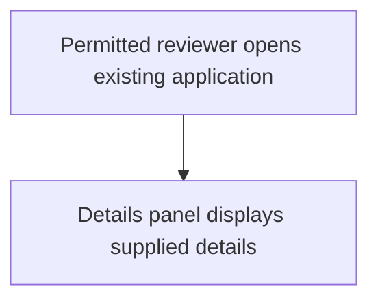

# Metadata and worked authoring examples

Read when assembling Story JSON and deriving its Test Case and SPEC projection. Examples are illustrative only, not default source facts.

## Metadata retention

Preserve supplied Author, Branch, Requirement ID, Parent Requirement ID, Market, Channel, Customer Type and Customer Segment in the templates where applicable. Keep exact field names; do not replace them with a generic "metadata" line.

Unknown values must not be fabricated. Omit optional unknown fields; if the user's delivery convention requires one, ask for it. Requirement ID is not a score review_id or audit_id. Locally assigned requirement IDs must be clearly identified as local, not portrayed as Jira/source IDs.

SPEC also retains:
- General feature requirements: supplied, approved GitHub commit-specific general-spec link.
- Overall architecture design: supplied, approved GitHub commit-specific architecture.md link.

Include these only when supplied and intended for the business deliverable; otherwise remove the fields. These explicit approved design references are exceptions to the ban on leaking internal evidence locators. Do not leak workspace paths, private download/token URLs, source registers or arbitrary provenance URLs. Test Case Related SPEC remains a workspace reference in the standalone workspace file, never an additional Jira attachment.

## Canonical business behavior and SPEC projection

Assume source explicitly says a permitted reviewer can open an existing application and see supplied details:

```text
* *AC-001*: Given a permitted reviewer and an existing application, when the reviewer opens the application, then the details panel displays the supplied application details.
```

Resolve the real AC field ID into acceptanceCriteria, then store this Jira wiki string in fields[that ID], preserving stable IDs and supported Given/When/Then detail. Use [text encoding](jira-text-format.md) before scoring. Derive the SPEC projection as Markdown with one Acceptance Criteria heading and - **AC-001**: for this same behavior. The mapping ID is not AC text, and there is no top-level acceptanceCriteria/bddScenarios array. No additional exact-heading parser rule is established by this example.

## Correct negative dispositions

| Source situation | Accurate test design |
|---|---|
| Valid submission and rejection of a specified invalid value are evidenced | Test acceptance and the specified rejection; put Covered on the rejection row as a compact authoring convention. |
| AC itself requires an unauthorized role to be denied access | Permission/Negative test verifies the denial; no artificial successful-access companion is required. |
| Read-only display AC has no meaningful additional negative behavior in confirmed scope | An executable display case with N/A and a specific rationale. |
| Source says rejection is required but does not define observable rejection outcome | Draft To Confirm with the exact missing behavior; no final PASS until evidence resolves it. |
| Independent input dimensions affect the expected result | Verify supported distinct outcomes with separate cases or explicit data/outcome rows; exclude impossible combinations. |
| One field offers equivalent A, B or C values | Explicit supported test data may be parameterized; do not infer required case count from the word "or". |

## Executable case illustration

Given supplied invalid-value rule and rejection message, a Validation row specifies the entry role/state, the exact invalid value, ordered input/submit/observe steps and the supplied visible rejection outcome. "Verify appropriate error" is not enough.

Use original 11 columns: Test Case Id; AC / Requirement Ref; Scenario Type; Negative Coverage Status; Coverage Rationale / To Confirm; Priority; Test Case Description; Preconditions; Test Data; Test Steps; Expected Results.

Do not hard-code messages, permission rules, field formats, thresholds or notification targets that evidence does not supply. Verification location belongs in steps/results (screen, returned state or another evidenced observation point).

## Diagram example

For the display-only source above, even this simple flow uses a minimal Mermaid diagram:


Use this fenced structure with the current Story's actual supported labels, not a default diagram to paste into other Stories. Keep the mermaid language marker and closing fence; do not wrap the block in another text/code fence or replace a simple flow with prose. Add error, empty, permission or dependency branches only when supported, and retain every source-required branch. If no user action/state transition applies, write Not applicable with a brief factual reason; missing business facts are not a reason to fabricate a graph or silently declare N/A.

## Recovery examples

- Correct JSON, incorrect SPEC diagram syntax/fence: repair only that presentation under the existing mechanical allowance; unchanged business meaning needs no full business re-review. If nodes/branches/outcomes change meaning, independently verify the affected consistency. Any change to an already scored SPEC still requires the existing current package score and fresh confirmation; do not rewrite correct JSON or repeat unrelated checks.
- Correct JSON AC, missing test: repair tests and embedded tables, independently verify affected content, synchronize headers and assess the changed package. SPEC content now participates in currentness; do not assume an old cached score is valid.
- Wrong Story requirement: repair the canonical JSON from evidence, align tests/SPEC, independently review and score the final files. Keep path identity unchanged where possible; do not score a report or an old Markdown file.
- A VALIDATION_FAILED result points to a JSON field/type: correct only that supported representation. Missing real business values require clarification, not guessed defaults.
- Actual canonical ACs still unrecognized: technical diagnosis, not endless rewording or an invented score.
- Preview changes business content: update JSON and dependent artifacts, review affected content, score and ask for fresh confirmation.
- After scoring, preserve SPEC byte content; display the actual numeric score in its independent record/UI. There is no score-header write or display-driven S2 call.
